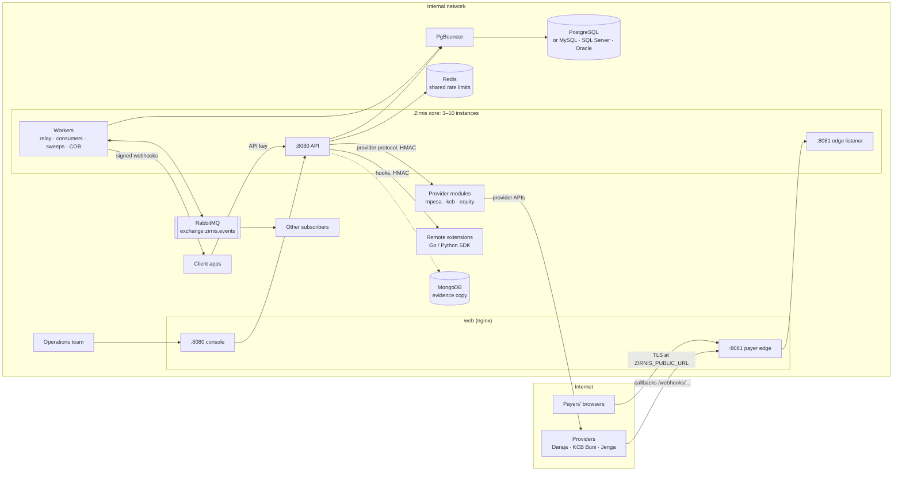
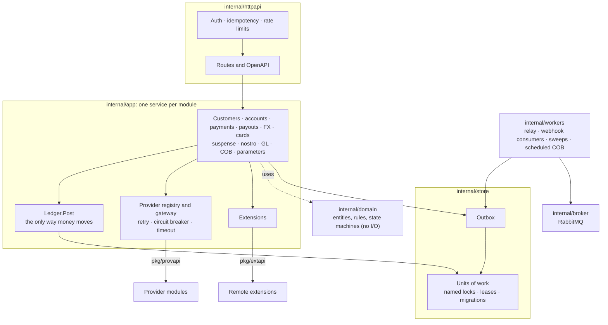
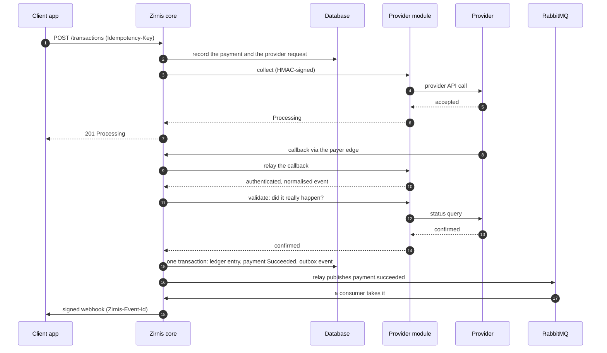

# Architecture

Zirnis is one Go binary, the **core**, in front of one relational database. Around it are:
- the web front (nginx), which serves the console and the payer edge;
- the provider modules, one small service per payment provider;
- optional infrastructure: PgBouncer, Redis, RabbitMQ and MongoDB.

Only the payer edge faces the internet.

## The system and its neighbours

| Component | Holds state? | Runs as | If it's down |
|---|---|---|---|
| **Database** | Yes: the system of record (ledger, audit chain, outbox, parameters) | Managed PostgreSQL in production | Zirnis is down: readiness fails and nothing is served |
| **Core** (`cmd/zirnis`) | No: everything is in the database | 3 to 10 instances, autoscaled | Other instances carry on. Leases move singleton jobs within three cycles |
| **web** (nginx) | No | 2 replicas | The console and payment links are unreachable; the API still works |
| **Provider modules** (`modules/`) | No: an OAuth token cache at most | 1–2 replicas each | Its provider's circuit opens, readiness reports *Degraded*, and routing fails over to other channels |
| **PgBouncer** | No | 2 replicas | As the database |
| **Redis** (optional) | Rate-limit counters only | 1 replica | Each instance counts its own requests |
| **RabbitMQ** (optional) | Messages in flight; the outbox keeps the truth | 1 node, or 3 with the Cluster Operator | Webhooks are late; events wait in the outbox |
| **MongoDB** (optional) | A second copy of the evidence | Managed | The evidence copy falls behind; money is unaffected |

**Network rules:**
- **The internet** reaches only the web front's port **8081**. It serves the checkout page, `/api/pay/{code}`, card returns and provider callbacks, and nothing else. The core's edge listener reads no API keys or sessions, so a misconfigured proxy still can't reach the API.
- **Provider modules** are reachable from the core only. Providers call Zirnis's public URL, and the core relays each call to the module.
- **The console** (8080) and the **API** (5080 in compose) stay on the internal network.

## Inside the core

- **One posting engine.** Every feature moves money through `Ledger.Post`, in the same transaction as its business change. Nothing else touches a balance, and entries are never changed: corrections are new entries.
- **Events leave through the outbox.** A business change and its event (`payment.succeeded`, `payout.paid`…) commit together. The workers deliver them later, so an event is never sent for a change that rolled back.
- **Providers are called outside any transaction.** Every request is recorded before it goes out, and a failure is classified:
  - **unavailable**, when the request never reached the provider. It's safe to retry and to fail over;
  - **ambiguous**, when the answer was lost. It's never re-sent; Zirnis asks the provider about it instead.
- **Extensions advise, never post.** The bank's own rules (matching, classification, vetoes) run as remote services. The core consults them before it opens a unit of work, and applies their decisions under its own controls.

## A payment end to end

- **A callback triggers the work but doesn't decide the outcome.** Zirnis asks the provider before any money moves.
- **A callback that never arrives:** a sweeper asks the provider after `ZIRNIS_STALE_AFTER`, two minutes by default.
- **A provider that never confirms:** the payment goes to operations, and its funds stay reserved until a maker and a checker settle it.

## Several instances

- **Close of business** runs on one instance at a time, under a lease. After it switches the business date, it waits until every live instance has finished the work that could still book to the closing day.
- **Background jobs** run under leases; another instance takes one over if its holder dies.
- **Webhooks** go through RabbitMQ when it's configured: a relay on every instance publishes, and consumers on every instance deliver. Without it, each instance claims outbox rows itself.
- **Authorised changes** reach every instance within 3 seconds. These are parameters, provider channels, module endpoints and rates.
- **Rate limits** are shared through Redis. Without Redis, each instance counts its own requests.

How to roll these out:
- the core: [deploying the core](runbooks/deploy-core.md);
- the modules: [deploying provider modules](runbooks/deploy-modules.md).
